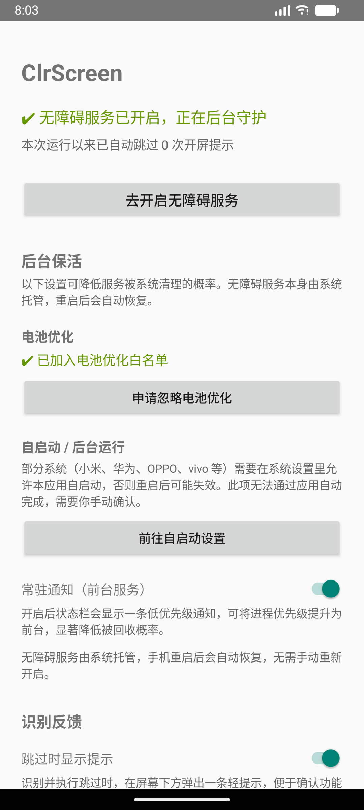

# ClrScreen 跳广告

一个开屏广告自动跳过工具。基于 Android 无障碍服务，在 App 启动出现开屏广告时自动点击「跳过」按钮。

**不联网、无广告、无第三方依赖、纯本机运行。** 保活所需的 5 个权限均不涉及网络。

- 包名：`com.clrscreen.skipad`
- 最低支持：Android 7.0（API 24）｜编译/目标：API 34
- 当前版本：1.2（versionCode 3）
- 判定方式：评分制（7 类信号加权 + 排除词一票否决）

---

## 它做什么

打开任意 App 时，如果它先展示开屏广告，本应用会在广告出现的瞬间扫描当前界面，对每个控件打分，得分够高才点击。

```
App 启动 ──▶ 开屏广告出现 ──▶ 扫描所有窗口的节点树
                                        │
                                        ▼
                              逐节点打分（文案/ID/位置/尺寸…）
                                        │
                    ┌───────────────────┴───────────────────┐
                    ▼                                       ▼
              命中排除词                               总分 ≥ 50
                    │                                       │
                    ▼                                       ▼
              直接否决，不点                          点击得分最高者
```

关键设计取舍：**用评分制替代关键词匹配**。旧版只要文字含「跳过」就点，会把「跳过此步骤」「跳过教程」全部点掉；现在这些词在排除列表里一票否决，同时靠位置和尺寸信号补偿，慢速广告和 WebView 广告也能命中。

---

## 快速开始

### 1. 安装

```bash
# 方式一：直接构建并安装到已连接的设备
./gradlew installDebug

# 方式二：先构建，再手动安装
./gradlew assembleDebug
adb install -r app/build/outputs/apk/debug/app-debug.apk
```

### 2. 开启服务

打开 App → 点击「去开启无障碍服务」→ 在系统无障碍设置中找到「**跳过开屏广告**」→ 打开开关 → 确认系统弹窗。

> 详见 [docs/使用指南.md](docs/使用指南.md)

### 3. 完成

无需任何其他操作。之后正常打开 App 即可，广告会被自动跳过。主界面会显示累计跳过次数。



---

## 文档导航

| 文档 | 内容 | 适合谁 |
|------|------|--------|
| [使用指南](docs/使用指南.md) | 安装、开启、日常使用、常见问题排查 | 普通用户 |
| [保活指南](docs/保活指南.md) | 后台保活机制、厂商设置、效果边界 | 遇到服务被杀的用户 |
| [工作原理](docs/工作原理.md) | 评分制算法、点击策略、防误触、边界情况 | 想了解细节的用户 / 开发者 |
| [开发指南](docs/开发指南.md) | 环境搭建、构建命令、代码导读、靶场测试 | 开发者 |
| [发布与签名](docs/发布与签名.md) | 签名配置、GitHub Actions 自动发版 | 维护者 |
| [隐私与安全](docs/隐私与安全.md) | 权限说明、数据处理、风险提示 | 关注隐私的用户 |
| [常见问题](docs/FAQ.md) | 集中问答 | 所有人 |

---

## 特性一览

| 特性 | 说明 |
|------|------|
| 评分制识别 | 文案/描述/控件ID/位置/尺寸/可点击性加权打分，总分 ≥ 50 才点击 |
| 排除词一票否决 | 「跳过此步骤」「跳过教程」「跳过片头」等直接排除，不参与打分 |
| 三级点击策略 | WebView 优先手势；原生控件 performAction → 祖先回溯 → 手势兜底 |
| 多窗口扫描 | 遍历 `getWindows()`，不只看活动窗口，覆盖悬浮层广告 |
| 密集重扫 | 定时扫描 0~6.5 秒共 11 次，之后靠内容变化事件持续到 8 秒 |
| 后台保活 | 前台服务常驻通知 + 电池优化白名单 + 开机自恢复 + 厂商自启动引导 |
| 完全离线 | 不申请 `INTERNET` 权限，无任何网络代码 |
| 零第三方依赖 | release 包约 620 KB |

> 保活需要 5 个权限（前台服务、通知、电池优化、开机广播等），均不涉及网络。详见 [隐私与安全](docs/隐私与安全.md#一权限清单)。

---

## 实测结果

用自带的测试靶场（[demo 模块](demo/)）跑了 22 个场景，覆盖各种广告形态与误伤场景。**19 项判定全部通过，0 失败**。

复现命令：

```bash
./gradlew :demo:installDebug
pwsh -File tools/run-scenarios.ps1 -Label final
```

> **关于稳定性**：多轮测试中曾出现一次 `touch_only` 未命中的抖动（单独重测 3/3 通过）。批量跑时每个场景依赖 `am start` 的时序，模拟器负载高时可能影响结果。要得到可信结论，建议连跑 2~3 轮。

### 应当跳过 —— 全部命中

| 场景 | 结果 |
|------|------|
| 标准文字按钮「跳过 5」 | ✅ |
| 右上角小字「跳过」 | ✅ |
| 仅无障碍描述（文字是「关闭」） | ✅ |
| 靠控件 ID `btn_skip_ad` 识别 | ✅ |
| 文字在子节点、父容器处理点击 | ✅ |
| 仅触摸监听（需手势） | ✅ |
| 英文「Skip Ad」 | ✅ |
| 延迟 3 秒出现 | ✅ |
| 倒计时结束后才可点 | ✅ |
| 透明遮罩上的跳过 | ✅ |
| 6 层嵌套节点 | ✅ |
| 「关闭广告」变体 | ✅ |
| 「5s \| 跳过」组合文案 | ✅ |
| WebView 内 H5 按钮 | ✅ |
| 全屏可点区域中的跳过 | ✅ |

### 应当忽略 —— 全部正确跳过

| 场景 | 结果 |
|------|------|
| 引导页「跳过此步骤」 | ✅ 不点 |
| 「跳过教程」 | ✅ 不点 |
| 长句「点击跳过可直接进入应用首页」 | ✅ 不点 |
| 播放器「跳过片头」 | ✅ 不点 |

### 已知无解 —— 观察项

| 场景 | 结果 | 说明 |
|------|------|------|
| Canvas 自绘「跳过」 | ❌ 识别不到 | 无障碍树中无文字/描述/ID |
| 纯图片按钮 | ❌ 识别不到 | 同上 |
| 延迟 8 秒出现 | ⚠️ 不稳定 | 在 6.5 秒窗口边缘，实测有时命中有时不中 |

> 关于 `late_8s`：按钮在 8 秒时创建，理论上超出 6.5 秒的定时扫描。但窗口内的内容变化事件（`TYPE_WINDOW_CONTENT_CHANGED`）在 `SPLASH_WATCH_WINDOW_MS = 8s` 内仍会触发扫描，所以偶尔能命中——**这是临界状态，不能依赖**。需要稳定覆盖 8 秒的广告，请调大 `SPLASH_WATCH_WINDOW_MS` 和 `SCAN_DELAYS_MS`，见 [开发指南](docs/开发指南.md#六可调参数)。

### 改进前后对比

| 指标 | 旧版（关键词命中即点） | 新版（评分制） |
|------|----------------------|---------------|
| 通过 | 13 | **19** |
| 失败 | 6 | **0** |
| 误伤（正常界面被点） | 4 个场景 | **0** |

---

## 已知限制

1. **自绘/图片按钮无法识别** —— 部分广告把「跳过」画在 Canvas 上或用图片，无障碍树里没有文字、描述和 ID，任何基于无障碍的方案都读不到。需图像识别才能解决。
2. **8 秒后出现的按钮不处理** —— 为防误触设的观察窗口。定时扫描覆盖 0~6.5 秒，之后靠内容变化事件撑到 8 秒，见 [工作原理](docs/工作原理.md#扫描时机为什么是-11-个时间点)。
3. **超过 12 字的文案不参与打分** —— 防止把说明文字当按钮，见 [工作原理](docs/工作原理.md#文字长度上限)。
4. **跳过次数不持久化** —— 存在内存里，进程被回收后归零。界面文案已改为「本次运行以来」。
5. **厂商 ROM 可能强杀后台** —— 已提供前台服务与引导，但仍需用户手动加白名单，见 [常见问题](docs/FAQ.md#服务老是自动关闭)。

---

## 项目结构

```
ClrScreen/
├── app/                                   # 主应用
│   ├── build.gradle.kts
│   └── src/main/
│       ├── AndroidManifest.xml
│       ├── java/com/clrscreen/skipad/
│       │   ├── MainActivity.kt                 # 主界面：状态、计数、保活设置入口
│       │   ├── SkipAdAccessibilityService.kt   # 无障碍服务：事件、扫描、点击
│       │   ├── SkipRuleEngine.kt               # 评分制判定引擎（纯逻辑，不依赖框架）
│       │   ├── KeepAliveService.kt             # 前台服务：常驻通知
│       │   ├── KeepAliveHelper.kt              # 电池优化 / 厂商自启动跳转
│       │   ├── BootReceiver.kt                 # 开机后恢复常驻通知
│       │   └── Prefs.kt                        # 轻量设置存储
│       └── res/
│           ├── layout/activity_main.xml
│           ├── values/strings.xml
│           ├── xml/accessibility_service_config.xml
│           └── drawable/ic_launcher.xml
├── demo/                                  # 测试靶场：22 种广告形态与误伤场景
│   └── src/main/java/com/clrscreen/skipad/demo/
│       ├── MainActivity.kt                     # 场景列表
│       ├── AdScenarioActivity.kt               # 各场景的具体实现
│       ├── Scenario.kt                         # 场景定义与期望
│       └── ResultLog.kt                        # 结果埋点（供 adb 断言）
├── tools/
│   └── run-scenarios.ps1                  # 自动化回归脚本
├── docs/
├── build.gradle.kts
├── settings.gradle.kts
└── gradle/wrapper/
```

---

## 常用命令

```bash
./gradlew assembleDebug        # 构建调试包
./gradlew installDebug         # 构建并安装主应用
./gradlew :demo:installDebug   # 安装测试靶场
./gradlew assembleRelease      # 构建已签名发布包（需 keystore.properties）
./gradlew lintDebug            # 静态检查
./gradlew clean                # 清理产物
```

跑自动化回归（需要连接设备 / 模拟器）：

```bash
pwsh -File tools/run-scenarios.ps1 -Label final
```

Windows 下把 `./gradlew` 换成 `.\gradlew.bat`。详见 [开发指南](docs/开发指南.md#二构建命令)。

---

## 发布

推送 `v*` 标签会自动构建、签名并创建 GitHub Release：

```bash
git tag v1.2
git push origin main --tags
```

签名密钥通过 GitHub Secrets 注入，**不在仓库中**。详见 [发布与签名](docs/发布与签名.md)。

---

## 许可证与免责

本项目为个人工具，未附许可证文件。

使用提示：无障碍服务是系统级高权限能力，请仅从可信来源安装本应用。本应用不联网、不上传任何数据，全部代码可自行审阅。因自动点击造成的任何后果由使用者自行承担。
