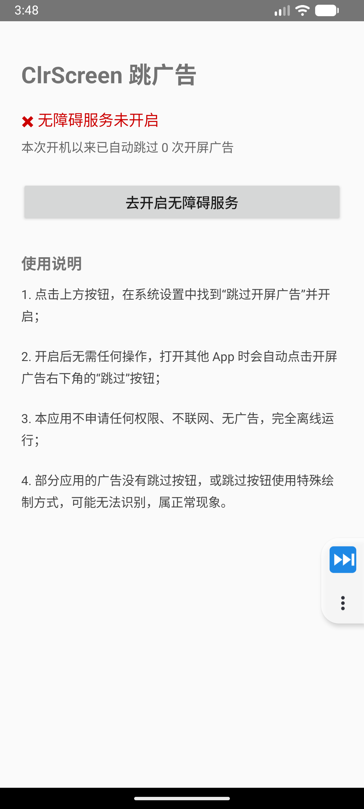
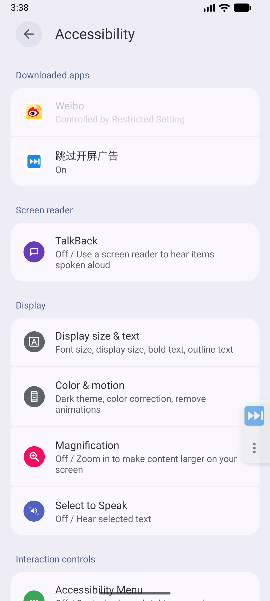

# 使用指南

面向普通用户：怎么装、怎么开、怎么用、出问题怎么办。

---

## 一、安装

### 从 APK 安装

1. 把 `app-debug.apk`（或已签名的 release 包）传到手机；
2. 用文件管理器点开安装；
3. 系统提示「未知来源应用」时，允许该文件管理器安装应用；
4. 安装完成后，桌面出现「**ClrScreen**」图标（蓝底渐变，白色手机与扫帚）。

### 用数据线安装

手机开启「USB 调试」并连接电脑后：

```bash
adb install -r app-debug.apk
```

---

## 二、开启服务（必做）

装完打开 App，你会看到主界面：



此时状态显示 **✖ 无障碍服务未开启**，说明服务还没工作。

### 操作步骤

1. 点击界面上的「**去开启无障碍服务**」按钮，会跳到系统无障碍设置页；
2. 在「**已安装的服务**」/「**已下载的应用**」列表中找到「**跳过开屏广告**」；
3. 点击它，打开开关；
4. 系统会弹出权限确认框，说明该服务可以查看屏幕内容、执行操作——点击「**允许**」；
5. 返回 ClrScreen，状态变为 **✔ 无障碍服务已开启，正在后台守护**。



开启成功后的主界面：


### 建议同时完成的保活设置

主界面下方有「后台保活」区块，两项建议都做一下：

1. **申请忽略电池优化** —— 点击按钮，系统弹窗选「允许」。不做的话，省电模式会冻结应用；
2. **前往自启动设置** —— 在系统页面里允许 ClrScreen 自启动。不做的话，重启后可能失效。

这两项都完成后，主界面的两个状态都应是 ✔。

> 详细说明见 [保活指南](保活指南.md)。

### 如果找不到入口

不同厂商的系统路径不同，可以手动走：

| 系统 | 路径 |
|------|------|
| 原生 Android / Pixel | 设置 → 无障碍 → 已下载的应用 |
| 小米 / Redmi（MIUI / HyperOS） | 设置 → 更多设置 → 无障碍 → 已下载的应用 |
| 华为 / 荣耀 | 设置 → 辅助功能 → 无障碍 → 已安装的服务 |
| OPPO / 一加 / realme | 设置 → 系统设置 → 无障碍 → 已安装的服务 |
| vivo / iQOO | 设置 → 快捷与辅助 → 无障碍 → 已下载的服务 |
| 三星 | 设置 → 辅助功能 → 已安装的应用 |

或在设置顶部的搜索框里直接搜「**无障碍**」。

> 部分系统把开关藏在「无障碍 → 已下载的应用」二级菜单里，需要先点进去才能看到。

---

## 三、日常使用

开启后**不需要任何操作**。

1. 正常打开任意 App；
2. 如果它展示开屏广告，ClrScreen 会自动识别并点击跳过按钮；
3. 回到 ClrScreen 主界面，可以看到累计次数：**「本次运行以来已自动跳过 N 次开屏广告」**。

### 关于计数

- 只在主界面 `onResume` 时刷新，看到的是进入界面那一刻的值；
- 存在内存中，**进程被系统回收后会归零**，不是持久统计；
- 文案「本次运行以来」是字面意思。

### 什么时候它不会动

这是正常的：

- 广告没有「跳过」按钮，只能等倒计时结束；
- 广告的跳过按钮是 Canvas 自绘或纯图片，无障碍读不到；
- 跳过按钮在 8 秒后才出现；
- 该 App 的开屏不是广告（直接进首页）。

### 关于状态栏通知

v1.1 起，开启「常驻通知」后状态栏会有一条低优先级通知（不响铃、不弹窗）。这是前台服务的系统要求，用来降低应用被回收的概率。

不想要的话，主界面把「常驻通知（前台服务）」开关关掉即可——功能仍然可用，但稳定性下降。

### 关于跳过时的轻提示

识别并执行跳过时，屏幕下方会弹出一条「已跳过开屏提示」的小提示，几秒后自动消失。

这条提示的作用是让你**确认功能确实生效了**——否则跳过太快，很难判断是应用自己跳过的还是 ClrScreen 帮你跳过的。

不想要的话，主界面「识别反馈」区块里把「跳过时显示提示」开关关掉即可。

---

## 四、验证是否生效

想确认服务真的在工作，可以这样测：

1. 打开一个**确实有开屏广告**的 App（如某些资讯、社交类 App）；
2. 观察广告页——「跳过」按钮应该被自动点掉，直接进入正文；
3. 回到 ClrScreen 主界面，计数应该 +1。

如果计数不增加，说明没识别到，见下面的排查。

---

## 五、关闭与卸载

### 临时关闭

系统设置 → 无障碍 → 找到「跳过开屏广告」→ 关闭开关。

关闭后服务立即停止，不再监听任何界面。

### 卸载

直接卸载 App 即可。系统会自动清理无障碍服务注册，无需手动操作。

> 建议先在系统设置里关掉无障碍开关再卸载，避免个别 ROM 残留注册项。

---

## 六、常见问题排查

### 服务显示已开启，但广告没被跳过

按顺序检查：

1. **该广告有没有「跳过」按钮？** 很多开屏广告只有倒计时，没有跳过入口，无法处理；
2. **跳过按钮是不是自绘或图片？** 如果按钮上的字看起来是图片、位置很特殊，很可能是 Canvas 绘制，无障碍读不到；
3. **按钮是不是 8 秒后才出现？** 超出观察窗口；
4. **按钮文字是否超过 12 字？** 例如「跳过提示了解更多活动详情吧」不参与文案打分；
5. **是否刚点过？** 1.2 秒冷却期内不会重复点击；
6. **服务是否被系统杀了？** 回到 ClrScreen 看状态，若变回 ✖ 说明被杀。

调试时可查看判定日志（仅 debug 包）：

```bash
adb logcat -s ClrScreen:D
```

### 误点了不该点的东西

v1.1 起，「跳过此步骤」「跳过教程」「跳过片头」等 11 个词组已列入排除词，实测不再误伤。

如果仍遇到误点，说明是排除词没覆盖的新文案。可以把该文案加进 `EXCLUDE_PHRASES`，或调高 `CLICK_THRESHOLD`。见 [开发指南 · 可调参数](开发指南.md#六可调参数)。

### 服务老是自动关闭

v1.1 已内置保活（前台服务 + 电池白名单 + 开机自恢复）。仍被关闭的话，先确认主界面两个状态都是 ✔，再按厂商补设：

| 系统 | 设置位置 |
|------|---------|
| 小米 / Redmi | 设置 → 应用设置 → 应用管理 → ClrScreen → 省电策略 → 无限制；并在最近任务里锁定 |
| 华为 / 荣耀 | 设置 → 电池 → 应用启动管理 → ClrScreen → 关闭「自动管理」，全部允许 |
| OPPO / 一加 / realme | 设置 → 电池 → 应用耗电管理 → ClrScreen → 允许后台运行 |
| vivo / iQOO | 设置 → 电池 → 后台高耗电 → 允许 ClrScreen |
| 三星 | 设置 → 电池 → 后台使用限制 → 从「休眠应用」中移除 |

另外检查是否开了「开发者选项 → 不保留活动」，开了会导致服务频繁重启。

完整说明见 [保活指南](保活指南.md)。

### 重启手机后失效

**v1.1 起不需要重新开启。** 实测确认无障碍服务由系统托管，重启后自动重新绑定；前台服务也会通过开机广播恢复。

如果重启后仍失效，检查是否在系统里禁用了 ClrScreen 的自启动权限。

### 主界面状态显示不正确

从系统设置返回后，主界面会在 `onResume` 时重新检测。如果状态没变，退出 App 再进一次。仍不对就重启手机——个别 ROM 的 `AccessibilityManager` 缓存有延迟。

### 安装了新版本，服务没了

覆盖安装后无障碍服务通常需要重新授权一次。重新走一遍「开启服务」。

---

## 七、安全提示

- 本应用**不申请网络权限**（`INTERNET`），无法联网；
- v1.1 新增的 5 个权限仅用于后台保活，均不涉及网络；
- 无障碍服务是系统级高权限能力，请确认 APK 来源可信；
- 全部代码可自行审阅，详见 [隐私与安全](隐私与安全.md)。

---

## 相关文档

- [保活指南](保活指南.md) —— 后台保活与厂商设置
- [工作原理](工作原理.md) —— 想了解它怎么判断「跳过」
- [开发指南](开发指南.md) —— 想自己改
- [常见问题](FAQ.md) —— 更多问答
